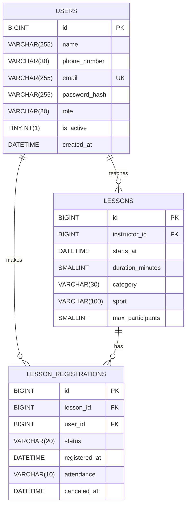

# Plan van eisen

## Teamgegevens

| Gegeven       | Waarde                                                                                 |
| ------------- | -------------------------------------------------------------------------------------- |
| Team          | —                                                                                      |
| Opdrachtgever | Ron de Wit, Sportcentrum De Linde                                                      |
| Repository    | [Sportcentrum-backend](https://github.com/vvendorrr/sportcentrum-backend "Repository") |
| Versie        | 1.9                                                                                    |
| Datum         | 25-09                                                                                  |

## Teamleden, rollen en deelproducten

| Naam     | Studentnummer | Scrum-rol     | Deelproduct        |
| -------- | ------------- | ------------- | ------------------ |
| Famke    | D315950       | Product owner | [Nog in te vullen] |
| Giovanni | D316667       | Scrum master  | [Nog in te vullen] |
| Lucas    | D310739       | Developer     | [Nog in te vullen] |

## Versiebeheer

| Versie | Datum | Wat is er gewijzigd                         | Door wie |
| ------ | ----- | ------------------------------------------- | -------- |
| 1.0    | 25/09 | Eerste versie                               | Famke    |
| 1.1    | 02/10 | Lucas toegevoegd                            | Famke    |
| 1.2    | 09/10 | Inleiding en doel verbeterd                 | Giovanni |
| 1.3    | 09/10 | Doelgroepen ingevuld                        | Giovanni |
| 1.4    | 09/10 | Basis ERD ingevuld, nheeft herziening nodig | Giovanni |
| 1.5    | 09/10 | Pagina’s en wireframe tabel ingevuld        | Giovanni |
| 1.6    | 09/10 | Studentennummers volledig ingevuld          | Giovanni |
| 1.7    | 09/10 | Scrum rollen volledig ingevuld              | Giovanni |
| 1.8    | 16/10 | Scope 'wel binnen dit project' aangevuld    | Famke    |
| 1.9    | 29/10 | User stories aangevuld                      | Giovanni |

## Inleiding

### De opdrachtgever en het probleem

De opdrachtgever is Ron de Wit, manager van Sportcentrum De Linde. Het sportcentrum heeft enkele honderden leden en organiseert wekelijks veel groepslessen.

De inschrijvingen en afmeldingen worden nu telefonisch en op papieren lijsten bijgehouden. Daardoor raken lessen soms overboekt, worden afmeldingen gemist en blijven plekken onnodig leeg. Trainers weten vooraf niet hoeveel deelnemers er komen en de manager heeft geen overzicht van de bezetting.

### Doel van website

De website geeft leden een duidelijk overzicht van de groepslessen en laat hen online inschrijven of afmelden. Zo blijft het aantal inschrijvingen binnen de beschikbare capaciteit en kunnen trainers en beheerders vooraf zien hoeveel deelnemers er worden verwacht.

### Scope

| Wel binnen dit project                                                                                                                   | Bewust buiten dit project |
| ---------------------------------------------------------------------------------------------------------------------------------------- | ------------------------- |
| - Database om makkelijk lessen bij te houden                                                                                             | [Nog in te vullen]        |
| - CRUD-Systeem om lessen toe te voegen aan Rooster                                                                                       | [Nog in te vullen]        |
| - Account-Systeem met Deelnemer, Trainer- en Admin accounts                                                                              | [Nog in te vullen]        |
| - Gedetailleerd overzicht van les-informatie; Naam, Type les, Datum, Duur, Trainer, Hoeveelheid Deelnemers en Hoeveelheid plekken in les | [Nog in te vullen]        |

### Doelgroepen

| Gebruiker         | Wat doet deze persoon op de website                                                                                                                       |
| ----------------- | --------------------------------------------------------------------------------------------------------------------------------------------------------- |
| Bezoeker          | Bekijkt het lesrooster en per les het aantal inschrijvingen, zonder de namen te zien. Kan een account aanmaken.                                           |
| Lid               | Schrijft zich in voor lessen en kan zich afmelden.                                                                                                        |
| Beheerder/Trainer | Maakt lessen aan en plant ze in het rooster, bekijkt wie zich heeft ingeschreven, ziet hoe vaak leden een les hebben gemist en kan accounts uitschakelen. |

## Functionele eisen

### Overzicht van de user stories

| ID    | User story                         | Deelproduct                  | Prioriteit | Sprint          | Wie                |
| ----- | ---------------------------------- | ---------------------------- | ---------- | --------------- | ------------------ |
| US-01 | Rooster bekijken                   | Frontend                     | Hoog       | 1               | [Nog in te vullen] |
| US-02 | Account aanmaken en inloggen       | Backend, Frontend & Security | Hoog       | 1               | [Nog in te vullen] |
| US-03 | Inschrijven voor een les           | Backend & Frontend           | Hoog       | 1               | [Nog in te vullen] |
| US-04 | Afmelden voor een les              | Backend & Frontend           | Hoog       | 1               | [Nog in te vullen] |
| US-05 | Deelnemers en aanwezigheid beheren | Backend & Frontend           | Hoog       | 1               | [Nog in te vullen] |
| US-06 | Lessen aanmaken en inplannen       | Backend & Frontend           | Hoog       | [In te plannen] | [Nog in te vullen] |
| US-07 | Accountgegevens beheren            | Backend, Frontend & Security | Gemiddeld  | [In te plannen] | [Nog in te vullen] |
| US-08 | Ledenaccounts uitschakelen         | Backend & Security           | Gemiddeld  | [In te plannen] | [Nog in te vullen] |
| US-09 | Traineraccounts beheren            | Backend, Frontend & Security | Gemiddeld  | [In te plannen] | [Nog in te vullen] |
| US-10 | Eigen inschrijvingen bekijken      | Backend & Frontend           | Gemiddeld  | [In te plannen] | [Nog in te vullen] |

### Uitgewerkte user stories

#### US-01 — Rooster bekijken — Hoog — Frontend — [Nog in te vullen]

> **Als** bezoeker wil ik het lesrooster en het aantal inschrijvingen per les bekijken, zodat ik kan zien welke lessen er zijn en hoeveel plekken nog beschikbaar zijn.

**Acceptatiecriteria**

- [ ] Het rooster toont per les de sport, starttijd, duur, trainer en maximale capaciteit.
- [ ] Het rooster toont het aantal ingeschreven deelnemers en het aantal resterende plekken.
- [ ] Een bezoeker kan geen namen van deelnemers bekijken.

#### US-02 — Account aanmaken en inloggen — Hoog — Backend, Frontend & Security — [Nog in te vullen]

> **Als** bezoeker wil ik een account aanmaken en kunnen inloggen, zodat ik me als lid voor lessen kan inschrijven.

**Acceptatiecriteria**

- [ ] Een bezoeker kan een account aanmaken met naam, e-mailadres, telefoonnummer en wachtwoord.
- [ ] Het systeem weigert registratie met een e-mailadres dat al in gebruik is.
- [ ] Na registratie kan de gebruiker inloggen met het aangemaakte account.

#### US-03 — Inschrijven voor een les — Hoog — Backend & Frontend — [Nog in te vullen]

> **Als** lid wil ik me voor een les kunnen inschrijven, zodat ik verzekerd ben van een plek of op de wachtlijst kom als de les vol is.

**Acceptatiecriteria**

- [ ] Een lid kan zich inschrijven voor een les met beschikbare plekken en krijgt de status `enrolled`.
- [ ] Is de les vol, dan krijgt het lid de status `waitlisted`.
- [ ] Een lid kan per les maximaal één actieve inschrijving hebben.

#### US-04 — Afmelden voor een les — Hoog — Backend & Frontend — [Nog in te vullen]

> **Als** lid wil ik me tijdig voor een les kunnen afmelden, zodat mijn plek beschikbaar komt voor een ander lid.

**Acceptatiecriteria**

- [ ] Een lid kan zichzelf afmelden tot twee uur voor de start van de les.
- [ ] Na afmelding wordt de inschrijving als geannuleerd geregistreerd.
- [ ] Als er een plek vrijkomt, wordt het eerstvolgende lid op de wachtlijst automatisch ingeschreven.

#### US-05 — Deelnemers en aanwezigheid beheren — Hoog — Backend & Frontend — [Nog in te vullen]

> **Als** beheerder/trainer wil ik deelnemers per les kunnen bekijken en hun aanwezigheid registreren, zodat ik weet wie er komt en gemiste lessen kan bijhouden.

**Acceptatiecriteria**

- [ ] Alleen een beheerder/trainer kan de namen van ingeschreven deelnemers bekijken.
- [ ] Een beheerder/trainer kan na afloop per deelnemer `attended` of `absent` registreren.
- [ ] Het aantal gemiste lessen van een lid is gebaseerd op diens afwezigheidsregistraties.

#### US-06 — Lessen aanmaken en inplannen — Hoog — Backend & Frontend — [Nog in te vullen]

> **Als** beheerder/trainer wil ik lessen kunnen aanmaken en inplannen, zodat leden het actuele lesaanbod kunnen bekijken en zich kunnen inschrijven.

**Acceptatiecriteria**

- [ ] Een beheerder/trainer kan een les aanmaken met een trainer, starttijd, duur, categorie, sport en maximale capaciteit.
- [ ] Alleen een bestaande gebruiker met de rol beheerder kan als trainer aan een les worden gekoppeld.
- [ ] Het systeem weigert een les met ontbrekende of ongeldige verplichte gegevens, zoals een capaciteit van nul.

#### US-07 — Accountgegevens beheren — Gemiddeld — Backend, Frontend & Security — [Nog in te vullen]

> **Als** ingelogde gebruiker wil ik mijn accountgegevens kunnen aanpassen, zodat mijn contactgegevens actueel blijven.

**Acceptatiecriteria**

- [ ] Een gebruiker kan de eigen naam en het eigen telefoonnummer aanpassen.
- [ ] Een gebruiker kan het eigen e-mailadres aanpassen als dit nog niet door een ander account wordt gebruikt.
- [ ] Een gebruiker kan geen accountgegevens van een andere gebruiker aanpassen.

#### US-08 — Ledenaccounts uitschakelen — Gemiddeld — Backend & Security — [Nog in te vullen]

> **Als** beheerder/trainer wil ik een ledenaccount kunnen uitschakelen, zodat een account niet langer toegang heeft tot de inschrijffuncties.

**Acceptatiecriteria**

- [ ] Alleen een beheerder/trainer kan een ledenaccount uitschakelen.
- [ ] Een uitgeschakeld lid kan niet inloggen.
- [ ] De accountgegevens en eerdere inschrijvingen van het lid blijven bewaard.

#### US-09 — Traineraccounts beheren — Gemiddeld — Backend, Frontend & Security — [Nog in te vullen]

> **Als** beheerder/trainer wil ik traineraccounts kunnen beheren, zodat alleen actieve trainers aan lessen gekoppeld kunnen worden.

**Acceptatiecriteria**

- [ ] Een beheerder/trainer kan een traineraccount aanmaken met naam, e-mailadres en telefoonnummer.
- [ ] Het systeem weigert een traineraccount met een e-mailadres dat al in gebruik is.
- [ ] Een uitgeschakelde trainer kan niet aan nieuwe lessen worden gekoppeld.

#### US-10 — Eigen inschrijvingen bekijken — Gemiddeld — Backend & Frontend — [Nog in te vullen]

> **Als** lid wil ik mijn lesinschrijvingen en wachtlijstplekken bekijken, zodat ik weet voor welke lessen ik ben aangemeld.

**Acceptatiecriteria**

- [ ] Een lid kan een overzicht bekijken van de eigen toekomstige inschrijvingen.
- [ ] Per les wordt getoond of de inschrijving actief of op de wachtlijst staat.
- [ ] Een lid kan geen inschrijvingen of persoonsgegevens van andere leden bekijken.

## Niet-functionele eisen

| Nr.                | Eis                | Hoe controleren we dit? |
| ------------------ | ------------------ | ----------------------- |
| [Nog in te vullen] | [Nog in te vullen] | [Nog in te vullen]      |

## Technische eisen en randvoorwaarden

| Onderwerp      | Afspraak                                                        |
| -------------- | --------------------------------------------------------------- |
| Framework      | Laravel 13                                                      |
| Views          | Blade-views met één gedeelde layout; geen React, Vue of Inertia |
| Database       | alle tabellen via migrations, gevuld met seeders                |
| Authenticatie  | Met de rollen lid en beheerder                                  |
| Validatie      | Form Requests met Nederlandstalige meldingen                    |
| Testen         | Minimaal 10 feature tests met _Pest / PHPUnit_                  |
| Versiebeheer   | GitHub, branches per user story, pull requests met review       |
| Overige keuzes | [Nog in te vullen]                                              |

## Datamodel

De `id`- en foreign-keykolommen zijn `BIGINT UNSIGNED`; `duration_minutes` en `max_participants` zijn `SMALLINT UNSIGNED`. `attendance` en `canceled_at` zijn nullable. De waarden voor `role` zijn `member` en `admin`; voor `category` zijn dit `strength`, `cardio` en `relaxation`; `status` gebruikt `enrolled`, `waitlisted` en `cancelled`; `attendance` gebruikt `attended` en `absent`.

| Entiteit               | Belangrijkste velden                                                                                                                       | Relaties                                                                                                                                             |
| ---------------------- | ------------------------------------------------------------------------------------------------------------------------------------------ | ---------------------------------------------------------------------------------------------------------------------------------------------------- |
| `users`                | `name`, `phone_number`, `email`, `password_hash`, `role` (`member`/`admin`), `is_active`, `created_at`                                     | Een beheerder/trainer kan meerdere lessen geven. Een gebruiker kan zich voor meerdere lessen inschrijven.                                            |
| `lessons`              | `instructor_id`, `starts_at`, `duration_minutes`, `category`, `sport`, `max_participants`                                                  | Een les heeft één trainer en kan meerdere inschrijvingen hebben.                                                                                     |
| `lesson_registrations` | `lesson_id`, `user_id`, `status` (`enrolled`/`waitlisted`/`cancelled`), `registered_at`, `attendance` (`attended`/`absent`), `canceled_at` | Koppelt een gebruiker aan een les. Een gebruiker kan per les maximaal één inschrijving hebben; een afgemelde inschrijving kan opnieuw actief worden. |

**Afspraken en regels**

- Het maximaal aantal deelnemers wordt per les opgeslagen. Richtwaarden zijn 16 voor spinning, 12 voor yoga en 20 voor aquagym/zwemlessen.
- Als een les vol is, krijgt een nieuwe inschrijving de status wachtlijst. Bij een vrijgekomen plek wordt de eerstvolgende op de wachtlijst automatisch ingeschreven.
- Een lid kan zichzelf tot twee uur voor aanvang afmelden. Een beheerder/trainer kan een deelnemer ook later afmelden.
- Een beheerder/trainer registreert na de les wie aanwezig of afwezig was. Het aantal gemiste lessen per lid kan worden berekend uit diens afwezigheidsregistraties.

## Pagina's en wireframes

| Pagina                  | Deelproduct                  | Toegankelijk voor                                                          | Wireframe                    | Goedgekeurd op     |
| ----------------------- | ---------------------------- | -------------------------------------------------------------------------- | ---------------------------- | ------------------ |
| Homepagina              | Frontend                     | Bezoeker, lid en beheerder                                                 | Home page                    | [Nog in te vullen] |
| Inloggen en registreren | Backend, Frontend & Security | Bezoeker (niet ingelogd)                                                   | Register/Signup              | [Nog in te vullen] |
| Accountinstellingen     | Frontend                     | Ingelogd lid en beheerder                                                  | Settings                     | [Nog in te vullen] |
| Uitloggen (actie)       | Backend & Security           | Ingelogd lid en beheerder                                                  | Navigatie; geen apart scherm | [Nog in te vullen] |
| Rooster                 | Frontend                     | Bezoeker, lid en beheerder; bezoekers zien alleen aantallen inschrijvingen | Rooster                      | [Nog in te vullen] |
| Deelnemers beheren      | Backend, Frontend & Security | Beheerder/trainer                                                          | Deelnemers                   | [Nog in te vullen] |
| Trainers beheren        | Backend, Frontend & Security | Beheerder/trainer                                                          | Trainers                     | [Nog in te vullen] |

## Afspraken met de klant

| Nr.                | Datum              | Afspraak           | Aanleiding         |
| ------------------ | ------------------ | ------------------ | ------------------ |
| [Nog in te vullen] | [Nog in te vullen] | [Nog in te vullen] | [Nog in te vullen] |

### Openstaande vragen

| Vraag              | Aan wie            | Sinds              | Status             |
| ------------------ | ------------------ | ------------------ | ------------------ |
| [Nog in te vullen] | [Nog in te vullen] | [Nog in te vullen] | [Nog in te vullen] |

## Wijzigingenlog

| Nr.                | Wat verandert er   | Gevolg voor planning of scope | Akkoord klant      |
| ------------------ | ------------------ | ----------------------------- | ------------------ |
| [Nog in te vullen] | [Nog in te vullen] | [Nog in te vullen]            | [Nog in te vullen] |

## Akkoord

| Namens               | Naam               | Datum              | Akkoord            |
| -------------------- | ------------------ | ------------------ | ------------------ |
| Namens het team (PO) | [Nog in te vullen] | [Nog in te vullen] | [Nog in te vullen] |
| Opdrachtgever        | Ron de Wit         | [Nog in te vullen] | [Nog in te vullen] |
