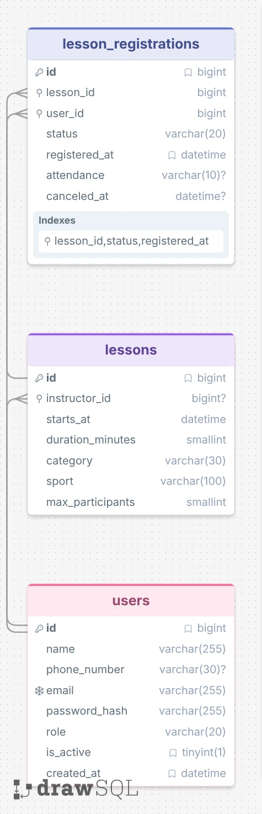

# Plan van eisen

## Teamgegevens

| Gegeven       | Waarde                                                                                 |
| ------------- | -------------------------------------------------------------------------------------- |
| Team          | —                                                                                      |
| Opdrachtgever | Ron de Wit, Sportcentrum De Linde                                                      |
| Repository    | [Sportcentrum-backend](https://github.com/vvendorrr/sportcentrum-backend "Repository") |
| Versie        | 0.4                                                                                    |
| Datum         | 10-11                                                                                  |

## Teamleden, rollen en deelproducten

| Naam     | Studentnummer | Scrum-rol     | Deelproduct                                            |
| -------- | ------------- | ------------- | ------------------------------------------------------ |
| Famke    | D315950       | Product owner | Plan van eisen (scope & user stories), product backlog |
| Giovanni | D316667       | Scrum master  | Datamodel (ERD) en wireframe-overzichten               |
| Lucas    | D310739       | Developer     | Rooster en lessenbeheer (US-01, US-05, US-06)          |

## Versiebeheer

| Versie | Datum | Wat is er gewijzigd     | Door wie        |
| ------ | ----- | ----------------------- | --------------- |
| 0.1    | 25/09 | Eerste versie           | Famke, Giovanni |
| 0.2    | 11/11 | Wijzigingen userstories | Famke, Giovanni |

## Inleiding

### De opdrachtgever en het probleem

De opdrachtgever is Ron de Wit, manager van Sportcentrum De Linde. Het sportcentrum heeft enkele honderden leden en organiseert wekelijks veel groepslessen.

De inschrijvingen en afmeldingen worden nu telefonisch en op papieren lijsten bijgehouden. Daardoor raken lessen soms overboekt, worden afmeldingen gemist en blijven plekken onnodig leeg. Trainers weten vooraf niet hoeveel deelnemers er komen en de manager heeft geen overzicht van de bezetting.

### Doel van website

De website geeft leden een duidelijk overzicht van de groepslessen en laat hen online inschrijven of afmelden. Zo blijft het aantal inschrijvingen binnen de beschikbare capaciteit en kunnen trainers en beheerders vooraf zien hoeveel deelnemers er worden verwacht.

### Scope

| Wel binnen dit project                                                                                                                   | Bewust buiten dit project                       |
| ---------------------------------------------------------------------------------------------------------------------------------------- | ----------------------------------------------- |
| - Database om makkelijk lessen bij te houden                                                                                             | Online betalingen en contributie-administratie  |
| - CRUD-Systeem om lessen toe te voegen aan Rooster                                                                                       | E-mail- of SMS-notificaties en herinneringen    |
| - Account-Systeem met Deelnemer, Trainer- en Admin accounts                                                                              | Mobiele app of koppelingen met externe systemen |
| - Gedetailleerd overzicht van les-informatie; Naam, Type les, Datum, Duur, Trainer, Hoeveelheid Deelnemers en Hoeveelheid plekken in les | Beheer van meerdere vestigingen of ruimtes      |

### Doelgroepen

| Gebruiker | Wat doet deze persoon op de website                                                                              |
| --------- | ---------------------------------------------------------------------------------------------------------------- |
| Bezoeker  | Bekijkt het lesrooster en per les het aantal inschrijvingen, zonder de namen te zien. Kan een account aanmaken.  |
| Lid       | Schrijft zich in voor lessen en kan zich afmelden.                                                               |
| Trainer   | Bekijkt de deelnemers en aanwezigheid van de eigen lessen en registreert wie aanwezig of afwezig was.            |
| Beheerder | Beheert leden- en traineraccounts, maakt lessen aan en plant deze in, en bekijkt de bezetting van het lesaanbod. |

## Functionele eisen

### Overzicht van de user stories

| ID    | User story                            | Deelproduct                  | Prioriteit | Sprint | Wie              |
| ----- | ------------------------------------- | ---------------------------- | ---------- | ------ | ---------------- |
| US-01 | Rooster bekijken                      | Frontend                     | Hoog       | 1      | Lucas            |
| US-02 | Account aanmaken en inloggen          | Backend, Frontend & Security | Hoog       | 1      | Lucas & Famke    |
| US-03 | Inschrijven voor een les              | Backend & Frontend           | Hoog       | 1      | Famke            |
| US-04 | Afmelden voor een les                 | Backend & Frontend           | Hoog       | 1      | Famke & Giovanni |
| US-05 | Deelnemers en aanwezigheid beheren    | Backend & Frontend           | Hoog       | 1      | Lucas            |
| US-06 | Lessen aanmaken en inplannen          | Backend & Frontend           | Hoog       | 2      | Lucas & Giovanni |
| US-07 | Accountgegevens beheren               | Backend, Frontend & Security | Gemiddeld  | 2      | Lucas & Famke    |
| US-08 | Ledenaccounts uitschakelen            | Backend & Security           | Gemiddeld  | 2      | Lucas            |
| US-09 | Traineraccounts beheren               | Backend, Frontend & Security | Gemiddeld  | 2      | Famke            |
| US-10 | Eigen inschrijvingen bekijken         | Backend & Frontend           | Gemiddeld  | 2      | Famke & Giovanni |
| US-11 | Rooster filteren                      | Backend & Frontend           | Gemiddeld  | 2      | Nog te bepalen   |
| US-12 | Bezettingsoverzicht voor beheerder    | Backend & Frontend           | Hoog       | 2      | Nog te bepalen   |
| US-13 | Afmelding door medewerker registreren | Backend & Frontend           | Hoog       | 2      | Nog te bepalen   |
| US-14 | Komende lessen voor trainer           | Backend & Frontend           | Hoog       | 2      | Nog te bepalen   |
| US-15 | Wachtlijststatus bekijken             | Backend & Frontend           | Gemiddeld  | 2      | Nog te bepalen   |
| US-16 | Rollen en bevoegdheden vaststellen    | Backend & Security           | Hoog       | 2      | Nog te bepalen   |
| US-17 | Onverwachte deelnemers afhandelen     | Backend & Frontend           | Gemiddeld  | 2      | Nog te bepalen   |
| US-18 | Nederlandstalige, sportieve website   | Frontend                     | Gemiddeld  | 2      | Nog te bepalen   |

### Uitgewerkte user stories

#### US-01 — Rooster bekijken — Hoog — Frontend — Lucas

> **Als** bezoeker wil ik het lesrooster en het aantal inschrijvingen per les bekijken, zodat ik kan zien welke lessen er zijn en hoeveel plekken nog beschikbaar zijn.

**Acceptatiecriteria**

- [ ] Het rooster toont per les de sport, starttijd, duur, trainer en maximale capaciteit.
- [ ] Het rooster toont het aantal ingeschreven deelnemers en het aantal resterende plekken.
- [ ] Een bezoeker kan geen namen van deelnemers bekijken.

#### US-02 — Account aanmaken en inloggen — Hoog — Backend, Frontend & Security — Lucas & Famke

> **Als** bezoeker wil ik een account aanmaken en kunnen inloggen, zodat ik me als lid voor lessen kan inschrijven.

**Acceptatiecriteria**

- [ ] Een bezoeker kan een account aanmaken met naam, e-mailadres, telefoonnummer en wachtwoord.
- [ ] Het systeem weigert registratie met een e-mailadres dat al in gebruik is.
- [ ] Na registratie kan de gebruiker inloggen met het aangemaakte account.

#### US-03 — Inschrijven voor een les — Hoog — Backend & Frontend — Famke

> **Als** lid wil ik me voor een les kunnen inschrijven, zodat ik verzekerd ben van een plek of op de wachtlijst kom als de les vol is.

**Acceptatiecriteria**

- [ ] Een lid kan zich inschrijven voor een les met beschikbare plekken en krijgt de status `enrolled`.
- [ ] Is de les vol, dan krijgt het lid de status `waitlisted`.
- [ ] Een lid kan per les maximaal één actieve inschrijving hebben.

#### US-04 — Afmelden voor een les — Hoog — Backend & Frontend — Famke

> **Als** lid wil ik me tijdig voor een les kunnen afmelden, zodat mijn plek beschikbaar komt voor een ander lid.

**Acceptatiecriteria**

- [ ] Een lid kan zichzelf afmelden tot twee uur voor de start van de les.
- [ ] Na afmelding wordt de inschrijving als geannuleerd geregistreerd.
- [ ] Als er een plek vrijkomt, wordt het eerstvolgende lid op de wachtlijst automatisch ingeschreven.

#### US-05 — Deelnemers en aanwezigheid beheren — Hoog — Backend & Frontend — Lucas

> **Als** trainer wil ik deelnemers van mijn lessen kunnen bekijken en hun aanwezigheid registreren, zodat ik weet wie er komt en gemiste lessen kan bijhouden.

**Acceptatiecriteria**

- [x] Alleen trainers die aan de les zijn gekoppeld en beheerders kunnen de namen van ingeschreven deelnemers bekijken.
- [x] Een trainer die aan de les is gekoppeld of een beheerder kan na afloop per deelnemer `attended` of `absent` registreren.
- [x] Het aantal gemiste lessen van een lid is gebaseerd op diens afwezigheidsregistraties.

> **Opm. status (11/11):** US-05 is geïmplementeerd. Het deelnemersoverzicht per les en het registreren van aanwezigheid zijn beschikbaar voor de gekoppelde trainer en beheerders; gemiste lessen worden afgeleid van afwezigheidsregistraties.

#### US-06 — Lessen aanmaken en inplannen — Hoog — Backend & Frontend — Lucas

> **Als** beheerder wil ik lessen kunnen aanmaken en inplannen, zodat leden het actuele lesaanbod kunnen bekijken en zich kunnen inschrijven.

**Acceptatiecriteria**

- [ ] Alleen een beheerder kan een les aanmaken met een trainer, starttijd, duur, categorie, sport en maximale capaciteit.
- [ ] Alleen een actieve gebruiker met de rol trainer kan aan een les worden gekoppeld.
- [ ] Het systeem weigert een les met ontbrekende of ongeldige verplichte gegevens, zoals een capaciteit van nul.

#### US-07 — Accountgegevens beheren — Gemiddeld — Backend, Frontend & Security — Lucas & Famke

> **Als** ingelogde gebruiker wil ik mijn accountgegevens kunnen aanpassen, zodat mijn contactgegevens actueel blijven.

**Acceptatiecriteria**

- [ ] Een gebruiker kan de eigen naam en het eigen telefoonnummer aanpassen.
- [ ] Een gebruiker kan het eigen e-mailadres aanpassen als dit nog niet door een ander account wordt gebruikt.
- [ ] Een gebruiker kan geen accountgegevens van een andere gebruiker aanpassen.

#### US-08 — Ledenaccounts uitschakelen — Gemiddeld — Backend & Security — Lucas

> **Als** beheerder wil ik een ledenaccount kunnen uitschakelen, zodat een account niet langer toegang heeft tot de inschrijffuncties.

**Acceptatiecriteria**

- [ ] Alleen een beheerder kan een ledenaccount uitschakelen.
- [ ] Een uitgeschakeld lid kan niet inloggen.
- [ ] De accountgegevens en eerdere inschrijvingen van het lid blijven bewaard.

> **Opm. status (11/11):** Een beheerder kan een ledenaccount uitschakelen vanuit het deelnemersoverzicht. Inactieve accounts kunnen niet inloggen; gegevens en eerdere inschrijvingen blijven bewaard.

#### US-09 — Traineraccounts beheren — Gemiddeld — Backend, Frontend & Security — Famke

> **Als** beheerder wil ik traineraccounts kunnen beheren, zodat alleen actieve trainers aan lessen gekoppeld kunnen worden.

**Acceptatiecriteria**

- [ ] Een beheerder kan een traineraccount aanmaken met naam, e-mailadres en telefoonnummer.
- [ ] Het systeem weigert een traineraccount met een e-mailadres dat al in gebruik is.
- [ ] Een uitgeschakelde trainer kan niet aan nieuwe lessen worden gekoppeld.

> **Opm. status (11/11):** Beheerders kunnen traineraccounts aanmaken, bijwerken en uitschakelen. Alleen actieve trainers kunnen aan nieuwe lessen worden gekoppeld; trainer en beheerder zijn aparte rollen.

#### US-10 — Eigen inschrijvingen bekijken — Gemiddeld — Backend & Frontend — Famke

> **Als** lid wil ik mijn lesinschrijvingen en wachtlijstplekken bekijken, zodat ik weet voor welke lessen ik ben aangemeld.

**Acceptatiecriteria**

- [ ] Een lid kan een overzicht bekijken van de eigen toekomstige inschrijvingen.
- [ ] Per les wordt getoond of de inschrijving actief of op de wachtlijst staat.
- [ ] Een lid kan geen inschrijvingen of persoonsgegevens van andere leden bekijken.

#### US-11 — Rooster filteren — Gemiddeld — Backend & Frontend — Nog te bepalen

> **Als** bezoeker wil ik het lesrooster kunnen filteren op week, categorie, trainer en sport, zodat ik snel lessen kan vinden die bij mijn voorkeuren passen.

**Acceptatiecriteria**

- [x] Een bezoeker kan het rooster filteren op week, categorie, trainer en sport/lesnaam.
- [x] Meerdere filters kunnen tegelijk worden toegepast; alleen lessen die aan alle geselecteerde filters voldoen worden getoond.
- [x] De gekozen filters blijven actief bij het navigeren naar de vorige of volgende week.
- [x] Een bezoeker kan de filters wissen zonder de gekozen week te wijzigen.

#### US-12 — Bezettingsoverzicht voor beheerder — Hoog — Backend & Frontend — Nog te bepalen

> **Als** beheerder wil ik in één overzicht de bezetting van lessen kunnen zien, zodat ik weet welke lessen vol zitten en welke nog veel vrije plekken hebben.

**Acceptatiecriteria**

- [x] Het overzicht toont per les de datum en tijd, sport, trainer, aantal inschrijvingen en maximale capaciteit.
- [x] Het overzicht maakt zichtbaar hoeveel plekken nog beschikbaar zijn en of een les vol is.
- [x] Een bezetting onder 50% is herkenbaar als laag; deze voorlopige grens is instelbaar en moet met de opdrachtgever worden bevestigd.

#### US-13 — Afmelding door medewerker registreren — Hoog — Backend & Frontend — Nog te bepalen

> **Als** bevoegde medewerker wil ik een afmelding namens een lid registreren, zodat een afmelding niet verloren gaat en de vrijgekomen plek beschikbaar komt.

**Acceptatiecriteria**

- [x] Alleen een beheerder kan namens een lid een actieve inschrijving annuleren.
- [x] Een beheerder mag na de zelfafmeldtermijn afmelden, maar alleen vóór de les begint; het afmeldtijdstip wordt geregistreerd.
- [x] Een vrijgekomen plek wordt automatisch aan de eerstvolgende wachtende toegekend.

> **Teamuitgangspunt:** trainers kunnen niet namens leden afmelden; beheerders mogen dit tot de start van de les. Bevestiging door de opdrachtgever blijft gewenst.

#### US-14 — Komende lessen voor trainer — Hoog — Backend & Frontend — Nog te bepalen

> **Als** trainer wil ik vóór mijn les de actuele deelnemerslijst en verwachte groepsgrootte kunnen bekijken, zodat ik weet hoeveel deelnemers ik kan verwachten.

**Acceptatiecriteria**

- [x] Een trainer kan de komende lessen zien waaraan die als trainer is gekoppeld.
- [x] Per les zijn de ingeschreven deelnemers, het aantal inschrijvingen en de maximale capaciteit zichtbaar.
- [x] Deelnemers op de wachtlijst zijn herkenbaar als wachtlijstdeelnemers en tellen niet mee als bevestigde inschrijvingen.
- [x] Alleen bevoegde gebruikers kunnen namen van deelnemers bekijken.

#### US-15 — Wachtlijststatus bekijken — Gemiddeld — Backend & Frontend — Nog te bepalen

> **Als** lid wil ik de actuele status van mijn lesinschrijving kunnen zien, zodat ik weet of ik een plek heb of op de wachtlijst sta.

**Acceptatiecriteria**

- [x] In het overzicht van eigen inschrijvingen is per les zichtbaar of de status `enrolled` of `waitlisted` is.
- [x] Als een lid vanaf de wachtlijst wordt ingeschreven, wordt de status in het overzicht bijgewerkt.
- [x] De website toont de status; een melding via e-mail of sms valt buiten de huidige scope en is nog geen afgesproken eis.

#### US-16 — Rollen en bevoegdheden vaststellen — Hoog — Backend & Security — Nog te bepalen

> **Als** manager wil ik vastgelegde rollen en bevoegdheden, zodat leden, trainers, beheerders en eventueel baliemedewerkers alleen passende acties kunnen uitvoeren.

**Acceptatiecriteria**

- [x] Lid, trainer en beheerder zijn aparte rollen; er is voorlopig geen aparte baliemedewerkerrol.
- [x] Bevoegdheden zijn vastgelegd in de rolmatrix hieronder.
- [x] De applicatie handhaaft bevoegdheden ook bij directe URL-aanroepen.
- [x] Autorisatie is met featuretests gecontroleerd.

| Rol       | Bevoegdheden                                                                                                                                                                   |
| --------- | ------------------------------------------------------------------------------------------------------------------------------------------------------------------------------ |
| Lid       | Publiek rooster bekijken; eigen profiel, inschrijvingen en tijdige afmeldingen beheren.                                                                                        |
| Trainer   | Eigen komende lessen en deelnemers bekijken; eigen profiel beheren; aanwezigheid registreren na afloop. Geen lessen of andere accounts beheren en geen afmelding namens leden. |
| Beheerder | Lessen en leden-/traineraccounts beheren; eigen profiel beheren; deelnemers van alle lessen bekijken; aanwezigheid registreren; namens leden afmelden tot de les start.        |

#### US-17 — Onverwachte deelnemers afhandelen — Gemiddeld — Backend & Frontend — Teamuitgangspunt

> **Als** trainer of beheerder wil ik weten hoe ik een deelnemer afhandel die zonder geldige inschrijving bij een les verschijnt, zodat de groepsgrootte niet ongemerkt boven de capaciteit uitkomt.

**Acceptatiecriteria**

- [x] Deelnemers zonder bevestigde inschrijving mogen niet aansluiten; een wachtlijststatus is geen bevestiging.
- [x] Trainers verwijzen iemand zonder bevestigde inschrijving naar de beheerder en overschrijden nooit de capaciteit. Er wordt geen aparte registratie voor inloopdeelnemers bijgehouden.

> **Teamuitgangspunt:** geen inloop zonder bevestigde inschrijving. Bevestiging door de opdrachtgever blijft gewenst.

#### US-18 — Nederlandstalige, sportieve website — Gemiddeld — Frontend — Nog te bepalen

> **Als** lid wil ik een Nederlandstalige website met een sportieve en energieke uitstraling, zodat het lesaanbod duidelijk en passend bij het sportcentrum wordt gepresenteerd.

**Acceptatiecriteria**

- [x] De zichtbare teksten en navigatie zijn Nederlandstalig; de standaard applicatietaal is Nederlands.
- [x] De vormgeving gebruikt blauw en wit met een sportieve uitstraling.
- [ ] De vormgeving wordt ter beoordeling aan de opdrachtgever voorgelegd voordat deze als definitief geldt.

## Niet-functionele eisen

| Nr.   | Eis                                                                                                                                  | Hoe controleren we dit?                                                                                                                                    |
| ----- | ------------------------------------------------------------------------------------------------------------------------------------ | ---------------------------------------------------------------------------------------------------------------------------------------------------------- |
| NFE-1 | **Beveiliging:** wachtwoorden worden gehasht opgeslagen en de applicatie is beschermd tegen CSRF.                                    | Feature tests voor registratie/inloggen; inspectie van migrations (`password_hash`) en Laravel-middleware                                                  |
| NFE-2 | **Autorisatie:** bezoekers zien geen namen van deelnemers; alleen leden kunnen zich inschrijven en alleen beheerders lessen beheren. | Policies (`LessonPolicy`) en Pest feature tests op HTTP-statuscodes                                                                                        |
| NFE-3 | **Betrouwbaarheid:** een les wordt nooit overboekt; wachtlijst-promotie gebeurt automatisch en in volgorde van aanmelding.           | Exclusieve unieke constraint (`lesson_id`, `user_id`) en feature tests (volle les → wachtlijst; afmelden → promotie)                                       |
| NFE-4 | **Bruikbaarheid:** de interface en validatiefouten zijn volledig Nederlandstalig en begrijpelijk geformuleerd.                       | Form Requests met Nederlandstalige meldingen; handmatig doorlopen van de flows                                                                             |
| NFE-5 | **Performance:** het rooster laadt binnen één seconde bij honderden leden en tientallen lessen, zonder N+1-queries.                  | Pest-regressietest met 200 leden en 30 lessen controleert lokaal minder dan één seconde en maximaal 10 SELECT-queries; benchmark in productie blijft nodig |
| NFE-6 | **Onderhoudbaarheid:** minimaal 10 feature tests en een consistente codestijl die met elke commit meekomt.                           | `vendor/bin/pint`; `vendor/bin/pest` (stand: 11/11 — 117 tests, 527 assertions, allemaal groen)                                                            |
| NFE-7 | **Data-integriteit:** alleen geldige waarden voor rol, categorie, status en aanwezigheid komen in de database.                       | Enum-kolommen in migrations; uniek e-mailadres (`users.email`); validatie weigert ongeldige invoer                                                         |

## Technische eisen en randvoorwaarden

| Onderwerp      | Afspraak                                                                                       |
| -------------- | ---------------------------------------------------------------------------------------------- |
| Framework      | Laravel 13, PHP ≥ 8.3                                                                          |
| Views          | Blade-views met één gedeelde layout; geen React, Vue of Inertia                                |
| Styling        | Tailwind CSS via Vite                                                                          |
| Database       | SQLite (standaard; MySQL kan via `.env`), alle tabellen via migrations, gevuld met seeders     |
| Tijdzone       | Lestijden worden als `Europe/Amsterdam` ingevoerd en getoond; opgeslagen tijdstippen zijn UTC. |
| Taal           | Nederlands (`nl`) voor interface en validatiemeldingen.                                        |
| Authenticatie  | Session-based, met de rollen `member` (lid), `trainer` en `admin` (beheerder)                  |
| Validatie      | Form Requests met Nederlandstalige meldingen                                                   |
| Testen         | Minimaal 10 feature tests met _Pest / PHPUnit_                                                 |
| Versiebeheer   | GitHub, branches per user story, pull requests met review                                      |
| Overige keuzes | Codestijl met Laravel Pint; routes en policies in de applicatiecode                            |

## Datamodel

De `id`- en foreign-keykolommen zijn `BIGINT UNSIGNED`; `duration_minutes` en `max_participants` zijn `SMALLINT UNSIGNED`. `phone_number`, `attendance` en `canceled_at` zijn nullable, net als `instructor_id`: die is nullable met `nullOnDelete`, zodat een account verwijderd kan worden zonder de lessen te verwijderen. De waarden voor `role` zijn `member`, `trainer` en `admin`; trainer en beheerder zijn aparte rollen. Voor `category` zijn dit `strength`, `cardio` en `relaxation`; `status` gebruikt `enrolled`, `waitlisted` en `cancelled`; `attendance` gebruikt `attended` en `absent`.

| Entiteit               | Belangrijkste velden                                                                                                                       | Relaties                                                                                                                                             |
| ---------------------- | ------------------------------------------------------------------------------------------------------------------------------------------ | ---------------------------------------------------------------------------------------------------------------------------------------------------- |
| `users`                | `name`, `phone_number`, `email`, `password_hash`, `role` (`member`/`trainer`/`admin`), `is_active`, `created_at`                           | Een trainer kan meerdere lessen geven. Een gebruiker kan zich voor meerdere lessen inschrijven.                                                      |
| `lessons`              | `instructor_id`, `starts_at`, `duration_minutes`, `category`, `sport`, `max_participants`                                                  | Een les heeft één trainer en kan meerdere inschrijvingen hebben.                                                                                     |
| `lesson_registrations` | `lesson_id`, `user_id`, `status` (`enrolled`/`waitlisted`/`cancelled`), `registered_at`, `attendance` (`attended`/`absent`), `canceled_at` | Koppelt een gebruiker aan een les. Een gebruiker kan per les maximaal één inschrijving hebben; een afgemelde inschrijving kan opnieuw actief worden. |

**Afspraken en regels**

- Het maximaal aantal deelnemers wordt per les opgeslagen. Richtwaarden zijn 16 voor spinning, 12 voor yoga en 20 voor aquagym/zwemlessen.
- Als een les vol is, krijgt een nieuwe inschrijving de status wachtlijst. Bij een vrijgekomen plek wordt de eerstvolgende op de wachtlijst automatisch ingeschreven.
- Een lid kan zichzelf tot twee uur voor aanvang afmelden. Volgens het teamuitgangspunt kan alleen een beheerder namens een lid afmelden, ook na die termijn maar alleen vóór de les start; bevestiging door de opdrachtgever blijft open.
- De gekoppelde trainer of een beheerder registreert na de les wie aanwezig of afwezig was. Het aantal gemiste lessen per lid kan worden berekend uit diens afwezigheidsregistraties.

## Pagina's en wireframes

| Pagina                  | Deelproduct                  | Toegankelijk voor                                                          | Wireframe                    | Goedgekeurd op     |
| ----------------------- | ---------------------------- | -------------------------------------------------------------------------- | ---------------------------- | ------------------ |
| Homepagina              | Frontend                     | Bezoeker, lid en beheerder                                                 | Home page                    | [Nog in te vullen] |
| Inloggen en registreren | Backend, Frontend & Security | Bezoeker (niet ingelogd)                                                   | Register/Signup              | [Nog in te vullen] |
| Accountinstellingen     | Frontend                     | Ingelogd lid en beheerder                                                  | Settings                     | [Nog in te vullen] |
| Uitloggen (actie)       | Backend & Security           | Ingelogd lid en beheerder                                                  | Navigatie; geen apart scherm | [Nog in te vullen] |
| Rooster                 | Frontend                     | Bezoeker, lid en beheerder; bezoekers zien alleen aantallen inschrijvingen | Rooster                      | [Nog in te vullen] |
| Deelnemers beheren      | Backend, Frontend & Security | Gekoppelde trainer en beheerder                                            | Deelnemers                   | [Nog in te vullen] |
| Trainers beheren        | Backend, Frontend & Security | Beheerder                                                                  | Trainers                     | [Nog in te vullen] |

## Afspraken met de klant

| Nr.                | Datum              | Afspraak           | Aanleiding         |
| ------------------ | ------------------ | ------------------ | ------------------ |
| [Nog in te vullen] | [Nog in te vullen] | [Nog in te vullen] | [Nog in te vullen] |

### Openstaande vragen

| Vraag                                                                                                                                                  | Aan wie    | Sinds              | Status                           |
| ------------------------------------------------------------------------------------------------------------------------------------------------------ | ---------- | ------------------ | -------------------------------- |
| Worden geslacht en geboortedatum van leden bewaard? Teamkeuze: niet verzamelen of opslaan zolang dit niet is goedgekeurd.                              | Ron de Wit | 06/11              | Teamkeuze; klantbevestiging open |
| Welke acties mogen trainers en beheerders elk uitvoeren, nu dit aparte rollen zijn? Teamvoorstel: rolmatrix bij US-16.                                 | Ron de Wit | 10/11              | Voorstel; bevestiging open       |
| Is een baliemedewerker een aparte rol? Teamvoorstel: nee; alleen lid, trainer en beheerder.                                                            | Ron de Wit | [Nog in te vullen] | Voorstel; bevestiging open       |
| Mogen leden zonder inschrijving aansluiten? Teamvoorstel: nee; alleen bevestigde inschrijvingen mogen deelnemen.                                       | Ron de Wit | [Nog in te vullen] | Voorstel; bevestiging open       |
| Moeten leden bij een wachtlijststatus of promotie alleen de website kunnen raadplegen, of is ook een melding gewenst? E-mail/sms valt nu buiten scope. | Ron de Wit | [Nog in te vullen] | Open                             |
| Welke grens bepaalt "weinig bezocht"? Teamvoorstel: minder dan 50% bezetting; de grens is instelbaar.                                                  | Ron de Wit | [Nog in te vullen] | Voorstel; bevestiging open       |

## Wijzigingenlog

| Nr.                | Wat verandert er   | Gevolg voor planning of scope | Akkoord klant      |
| ------------------ | ------------------ | ----------------------------- | ------------------ |
| [Nog in te vullen] | [Nog in te vullen] | [Nog in te vullen]            | [Nog in te vullen] |

## Akkoord

| Namens               | Naam               | Datum              | Akkoord            |
| -------------------- | ------------------ | ------------------ | ------------------ |
| Namens het team (PO) | [Nog in te vullen] | [Nog in te vullen] | [Nog in te vullen] |
| Opdrachtgever        | Ron de Wit         | [Nog in te vullen] | [Nog in te vullen] |
